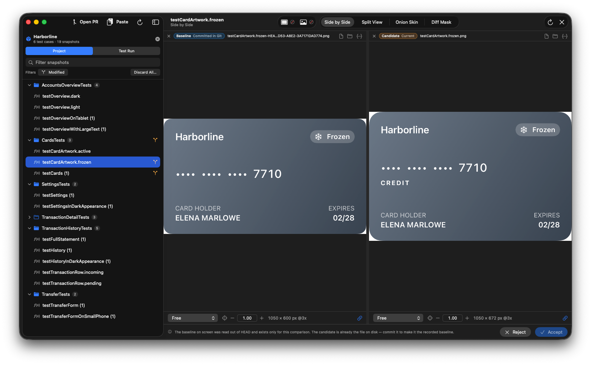
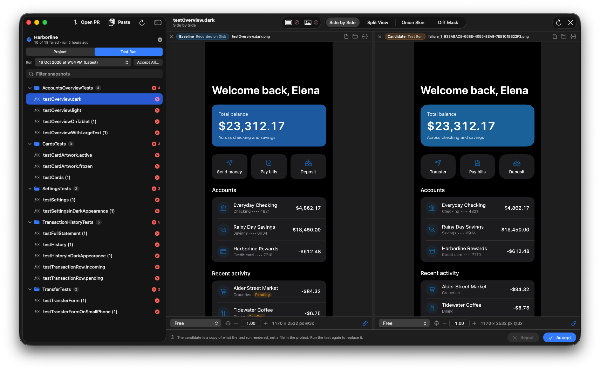

<p align="center">
  
</p>

<h1 align="center">GimDiff</h1>

A native macOS app for reviewing snapshot tests: find every reference image in a project,
compare it with what the last test run rendered, and accept or reject the change without
leaving the window.

GimDiff reads the folders snapshot libraries already write. It needs no plugin and no
change to your tests.



## Features

- **Finds your snapshots.** Recognises
  [swift-snapshot-testing](https://github.com/pointfreeco/swift-snapshot-testing),
  modular `Snapshots/` folders, [Paparazzi](https://github.com/cashapp/paparazzi), and
  plain image folders. Anything else can be described in a `.gimdiffrc.json`.
- **Compares them several ways.** Side by side, split view, onion skin, and a difference
  mask whose tolerance is a perceptual colour distance (CIE76 ΔE), not a byte threshold.
- **Reads your last test run.** Lists the failures in the newest Xcode result bundle (or
  Paparazzi's failure folder), pairs each one with its recorded snapshot, and lets you
  accept them one at a time or all at once.
- **Knows about Git.** Marks modified snapshots, compares the working file with `HEAD`, and
  reverts a change. Every write can be undone.
- **Reviews pull requests.** Downloads the snapshots a GitHub pull request changes, Git LFS
  included, without checking the branch out.
- **Keeps up on its own.** Watches the project with FSEvents, so a test run that rewrites
  images shows up without a refresh.
- **Comes with a command-line tool.** `gimdiff` scans, diffs, and exports test-run failures
  on a build machine, and hands paths to the running app from a terminal.



## Requirements

- macOS 14 Sonoma or later
- Xcode 26 to build
- [GitHub CLI](https://cli.github.com) (`gh`), signed in, for pull request review only

## Building

```sh
git clone https://github.com/DavidGiordana/GimDiff.git
cd GimDiff
open GimDiff.xcodeproj
```

Run the **GimDiff** scheme. A fresh clone signs to run locally, so no Apple Developer
account is needed. To sign with your own team instead, see [Code signing](CONTRIBUTING.md#code-signing).

From the command line:

```sh
xcodebuild -scheme GimDiff -destination 'platform=macOS' build
```

### Installing the command-line tool

```sh
xcodebuild -scheme gimdiff -configuration Release -derivedDataPath build build
cp build/Build/Products/Release/gimdiff /usr/local/bin/
```

## Usage

Open a project folder from the app, drop two images on the window, or paste a failing
test's log (⌘V) and GimDiff pulls out the images it names. *Help ▸ GimDiff Help* covers
the rest.

### Command line

```
gimdiff scan <project-path> [--json]
gimdiff diff <candidate> <baseline> [--out <mask.png>] [--tolerance <ΔE>] [--json]
gimdiff test-run <project-path> [--result <bundle>] [--out <folder>] [--tolerance <ΔE>] [--json]
gimdiff parse-clipboard [--input "<log text>"] [--json]
gimdiff pr <url-or-number>             # opens a GitHub pull request in the app
gimdiff <project-path>                 # opens a project in the app
gimdiff <candidate> <baseline>         # opens one comparison in the app
```

Exit codes: `0` nothing to report, `1` the images or the project differ, `2` the command
could not run, `64` the arguments were not usable.

### URL scheme

```
gimdiff://open?path=/path/to/snapshots
gimdiff://compare?reference=/path/a.png&failure=/path/b.png
gimdiff://open-pr?url=https://github.com/owner/repo/pull/123
```

### Project configuration

Drop a `.gimdiffrc.json` in the project root when the conventions don't fit. Every field
is optional:

```json
{
  "snapshotsDirectory": "UITests/References",
  "extensions": ["png"],
  "testFilePattern": "UITests/{suite}Tests.swift",
  "ignoredPaths": ["Vendor"]
}
```

## Contributing

Contributions are welcome. Read [CONTRIBUTING.md](CONTRIBUTING.md) first, and
[DEVELOPMENT.md](DEVELOPMENT.md) for the architecture and the rules the code follows.

## License

GimDiff is released under the [MIT License](LICENSE).
